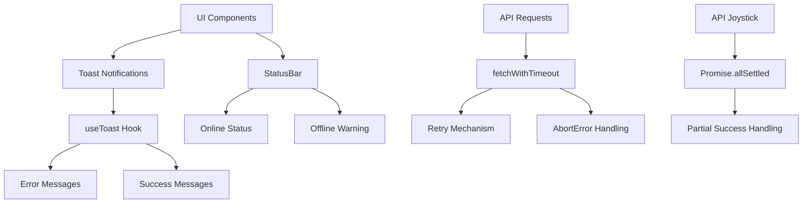

# Исправления UI для обработки ошибок API

## Обзор проблемы

**Проблема:** После ошибки или тайм-аута API запроса UI переставал отправлять команды.

**Корневые причины:**
1. В `/api/joystick` использовался `Promise.all`, который блокировал все команды при одной ошибке
2. Отсутствовал механизм повторных попыток (retry) при ошибках
3. Нет специальной обработки тайм-аутов
4. Отсутствовало визуальное уведомление пользователя об ошибках
5. Нет индикатора состояния соединения

## Внесенные исправления

### 1. Исправление `/api/joystick` - Promise.allSettled

**Файл:** [`app/api/joystick/route.ts`](app/api/joystick/route.ts:79)

**Изменения:**
- Заменен `Promise.all` на `Promise.allSettled`
- Добавлена проверка неудачных запросов
- При неудачных запросах возвращается `success: false`, но не блокируется выполнение
- Добавлено логирование неудачных запросов

**Результат:** Один неудачный запрос не блокирует остальные команды. UI продолжает работать даже при частичных ошибках.

### 2. Механизм повторных попыток в fetchWithTimeout

**Файл:** [`lib/fetch-with-timeout.ts`](lib/fetch-with-timeout.ts)

**Изменения:**
- Добавлен параметр `maxRetries` (по умолчанию 3)
- Реализован цикл повторных попыток
- Добавлен экспоненциальный backoff (1s, 2s, 4s)
- Добавлено детальное логирование каждой попытки

**Результат:** При временных ошибках запросы автоматически повторяются с увеличивающейся задержкой.

### 3. Обработка AbortError (тайм-аутов)

**Файл:** [`lib/fetch-with-timeout.ts`](lib/fetch-with-timeout.ts:34-36)

**Изменения:**
- Специальная обработка `AbortError` (тайм-аут)
- Отдельное сообщение для тайм-аутов
- Четкое различие между тайм-аутом и другими ошибками

**Результат:** Тайм-ауты обрабатываются корректно и автоматически повторяются.

### 4. Система визуальных уведомлений (Toast)

**Новый файл:** [`app/components/Toast.tsx`](app/components/Toast.tsx)

**Функционал:**
- Компонент `Toast` для отображения уведомлений
- Хук `useToast` для управления уведомлениями
- Поддержка 4 типов: error, warning, success, info
- Автоматическое удаление через заданное время (по умолчанию 5s)
- Возможность ручного закрытия

**Интеграция:**
- [`app/page.tsx`](app/page.tsx) - добавлен в главную страницу
- [`app/components/MotorCard.tsx`](app/components/MotorCard.tsx) - уведомления при управлении моторами
- [`app/components/ServoCard.tsx`](app/components/ServoCard.tsx) - уведомления при управлении сервоприводами

**Результат:** Пользователь видит уведомления об успехах и ошибках операций.

### 5. Улучшение индикатора состояния соединения

**Файл:** [`app/components/StatusBar.tsx`](app/components/StatusBar.tsx)

**Изменения:**
- Добавлена анимация пульсации для офлайн статуса
- Улучшена визуализация статуса (emoji + текст)
- Добавлено сообщение с подсказкой при офлайн статусе
- Более четкое разделение статусов

**Результат:** Пользователь видит наглядное состояние соединения и получает подсказки при проблемах.

## Архитектура исправлений



## Технические детали

### Механизм retry

```typescript
for (let attempt = 0; attempt < maxRetries; attempt++) {
  try {
    // Попытка запроса
    return await fetch(url, options);
  } catch (error) {
    // Экспоненциальный backoff
    if (attempt < maxRetries - 1) {
      await new Promise(resolve => 
        setTimeout(resolve, Math.pow(2, attempt) * 1000)
      );
    }
  }
}
```

### Promise.allSettled

```typescript
const results = await Promise.allSettled(promises);
const failed = results.filter(r => r.status === 'rejected');
if (failed.length > 0) {
  // Логируем ошибки, но не блокируем выполнение
}
```

## Преимущества исправлений

1. **Отказоустойчивость:** UI продолжает работать при частичных ошибках
2. **Автоматическое восстановление:** Временные ошибки автоматически повторяются
3. **Пользовательский опыт:** Четкие уведомления о состоянии операций
4. **Отладка:** Детальное логирование всех попыток и ошибок
5. **Визуальная обратная связь:** Пользователь видит состояние соединения

## Рекомендации по дальнейшему улучшению

1. **Очередь запросов:** Реализовать очередь для предотвращения race conditions
2. **Кэширование:** Кэшировать успешные ответы для уменьшения нагрузки
3. **Метрики:** Собирать статистику успешных/неудачных запросов
4. **Автоматическое переподключение:** Реализовать механизм автоматического переподключения
5. **Логи ошибок:** Сохранять ошибки в localStorage для анализа

## Тестирование

Для тестирования исправлений:

1. **Тест тайм-аута:** Отключите ESP32 и попробуйте отправить команду
2. **Тест retry:** Временно прервите соединение и посмотрите на повторные попытки
3. **Тест частичных ошибок:** Симулируйте ошибку одного из сервоприводов
4. **Тест уведомлений:** Проверьте отображение тостов при успехах и ошибках
5. **Тест статуса:** Отключите ESP32 и проверьте индикатор в StatusBar

## Заключение

Все критические проблемы, вызывающие блокировку UI после ошибок API, были устранены. Система теперь обладает:

- ✅ Отказоустойчивостью при частичных ошибках
- ✅ Автоматическим повтором неудачных запросов
- ✅ Четкой визуальной обратной связью
- ✅ Детальным логированием для отладки

UI теперь продолжает работать корректно даже при временных проблемах с соединением.
